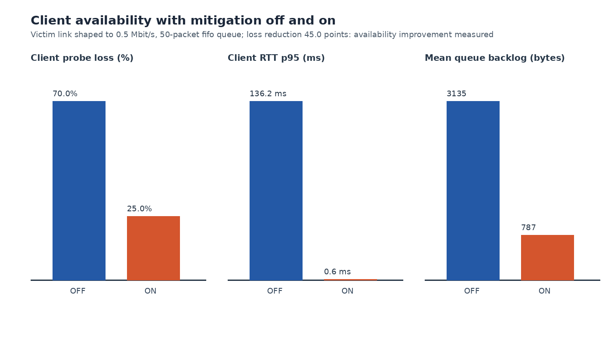

# FlowGuard: SDN DDoS detection and mitigation

FlowGuard is a Computer Networks lab project about a UDP flood against one
protected service. In a **private Mininet network**, an OS-Ken controller
polls Open vSwitch flow counters every second, attributes the flood to its
sources, and installs short-lived OpenFlow rules for those sources while a
legitimate client keeps probing the same victim (`10.0.0.10:9000`). The same
detector and response code also runs in an offline dashboard and in a native
localhost lab that sends real UDP datagrams on any operating system.

The `feature/advanced-networking` branch extends the original project with
adaptive detectors, rate limiting with OpenFlow meters, a graduated response
with back-off, a real bottleneck (so availability can actually be measured), a
binary probe protocol with standard QoS metrics, and a Wireshark dissector.

For a start-to-finish explanation of the original network, detector, rules,
evidence and review presentation, read the
[complete project guide](docs/PROJECT_EXPLAINED.md).

## What the measured results show

**Original matched Mininet trials (M6, 13 October 2026; historical).** In the matched
600-packets/s-per-source trials, the switch confirmed mitigation in 1.634
seconds and victim-received attacker traffic fell to zero in complete
post-confirmation windows. The legitimate client received 80/80 replies with
mitigation. It also received 80/80 without mitigation, so **improved service
availability was not demonstrated**. See [results and limitations](docs/RESULTS.md)
and the [saved comparison chart](results/m6-rate-comparison.png).

**Native bottleneck trials (M9, 21 October 2026).** With an emulated
300 packets/s, 50-packet bottleneck in front of the victim, the protected
client's attack-phase loss fell from 71.2 % (mitigation OFF) to 23.8 % (ON),
and its RTT p95 from 166.7 ms to 5.2 ms ([evidence](results/M9_NATIVE_EVIDENCE.md),
[all runs](docs/RESULTS.md#m9-advanced-results)). This is real localhost UDP
through a **userspace** queue model, not an OpenFlow switch or kernel qdisc.

**Live Mininet / Open vSwitch runs (M8, 22 October 2026).** With a real
0.5 Mbit/s HTB + 50-packet netem queue on the switch port toward the victim
(verified with `tc`), client attack-phase loss fell from 70.0 % (OFF) to
25.0 % (ON) and RTT p95 from 136.2 ms to 0.6 ms; queue drops fell from 6,677
to 1,721. OpenFlow 1.3 meters at 20 packets/s were accepted by OVS 3.3.9
(`actions=meter:1021,output:1`) and dropped 6,735 packets in their bands;
CUSUM with the graduated response rate-limited the first wave for 10 s and
dropped the second for 20 s (back-off). Ubuntu 24.04.3, Mininet 2.3.0,
OS-Ken 4.1.1. Details: [M8 results](docs/RESULTS.md#m8-live-mininet--open-vswitch-runs).
Meter fallback on a live switch was not exercised (this OVS supports meters).



The traffic generator is fixed to `10.0.0.10:9000` inside the Mininet
topology and enforces a maximum of 2,000 packets/s per source for 30 seconds.
The topology has no NAT or external link. The project supports this IPv4 UDP
lab scenario; it is not a production DDoS defense.

The course [PDF report](reports/FlowGuard_BCSE308P_Project_Report.pdf) and
[editable Word report](reports/FlowGuard_BCSE308P_Project_Report.docx) are
included; they describe the original (M6) results. Team names and
registration details are intentionally blank for the owner to fill before
submission.

## Limitations of the original design, and what changed

| Original limitation | Why it matters | What this branch adds | Technical significance |
|---|---|---|---|
| One fixed-threshold detector (>100 pps total, >30 pps from ≥2 sources, 2 windows) | Misses a single source, sub-threshold floods and pulsing attacks; alarms on flash crowds | EWMA control chart, Page CUSUM, KL-divergence (traffic-mix) detectors, selectable by config/CLI; seeded benchmark over 11 scenarios | Shows the detection/false-alarm trade-off quantitatively; CUSUM is the only one that catches pulsing, entropy the only one quiet on a flash crowd |
| Drop-only response with a fixed 10 s rule | All-or-nothing; a repeat attacker is treated like a first-timer | Token-bucket rate limit (OpenFlow 1.3 meter in OVS, Python bucket natively), graduated policy (rate-limit first, drop on repeat), exponential back-off of rule lifetime | Introduces policing vs dropping, meters, capability discovery and error-driven fallback |
| No bottleneck: the victim link was never congested | Availability improvement could not be measured (80/80 replies OFF and ON) | Mininet `TCLink` (HTB rate + netem FIFO) on the victim link with `tc` verification and sampling; native D/1 FIFO/RED queue model; OFF/ON availability comparison | Makes loss, queueing delay and the value of mitigation measurable |
| ASCII probes, success/fail only | No loss pattern, percentiles or jitter | FGPB 32-byte binary probe header with session, sequence, timestamp and CRC32; RFC 3550 jitter, nearest-rank RTT percentiles, late/duplicate/reorder counts | Standard QoS metrics, application-layer protocol design |
| Wireshark showed raw UDP bytes | Payloads had to be read by hand | Lua heuristic dissector and a Wireshark profile with I/O graphs and filter buttons | Protocol fields become filterable (`flowguard.seq`, `flowguard.crc_ok`) |
| Single detector state, no telemetry | Hard to explain decisions | Detector scores and state in every `sample` event; meter, rate-limit and OpenFlow-error events | Every decision in the timeline is backed by a logged reason |

## Three ways to run it

| | Dashboard and guided terminal | Native localhost lab | Mininet / Open vSwitch |
|---|---|---|---|
| OS | Windows, macOS, Linux | Windows, macOS, Linux | Linux (Ubuntu, or WSL2 with systemd) |
| Privileges / packages | none; Python ≥ 3.12 stdlib | none; Python ≥ 3.12 stdlib | root; Mininet, Open vSwitch, OS-Ken 4.1.1 |
| Traffic | **simulated** counters through the real detectors | **real** UDP on 127.0.0.1 | **real** UDP between network namespaces |
| Enforcement | modelled | Python gateway (drops/polices real datagrams) | OVS flow table and meters (real OpenFlow) |
| Bottleneck | fluid queue model | userspace D/1 FIFO or RED queue | Linux HTB + netem qdisc on `s1-eth1` |

### Quick start

```bash
# 1. Dashboard (open http://127.0.0.1:8765/)
python3 demo/server.py

# 2. Guided terminal presentation: preflight, detector, recorded SDN evidence,
#    live native OFF/ON, detector benchmark, native bottleneck
python3 demo/terminal.py --step
python3 demo/terminal.py --section bottleneck        # just the availability experiment

# 3. Native lab directly
python3 demo/live_lab.py                                             # original behaviour
python3 demo/live_lab.py --bottleneck-pps 300 --queue-packets 50     # availability OFF vs ON
python3 demo/live_lab.py --bottleneck-pps 300 --queue-packets 50 --action rate_limit
python3 demo/live_lab.py --mitigation on --bottleneck-pps 300 --queue-packets 50 \
    --action graduated --backoff --waves 3

# 4. Mininet / OVS (Linux, root)
sudo python3 experiments/demo.py                                    # original narrated trial
sudo python3 experiments/demo.py --bottleneck --compare --pcap      # availability OFF vs ON
sudo python3 experiments/demo.py --bottleneck --compare --mitigation-action rate_limit
```

On Windows use `py -3`, or double-click **Start FlowGuard.cmd** (dashboard)
and **Terminal Demo.cmd** (terminal) in the extracted package; see
[WINDOWS_DEMO.md](WINDOWS_DEMO.md) and [RUN_FIRST.txt](RUN_FIRST.txt). On a
Mac, **Start FlowGuard.command** starts the dashboard. Linux setup for the
Mininet runtime is in [TESTING](docs/TESTING.md#3-linux-lab-setup).

### Dashboard modes

- **Interactive model:** eleven traffic stories (the original six plus
  pulsing, slow ramp, flash crowd, three sources, repeat offender). "Tune the
  model" selects the detector, response (drop / rate-limit / graduated),
  rate-limit rate, back-off and a bottleneck queue. Generated counters pass
  through the actual detector classes; the model sends no attack packets and
  installs no switch rules. Capacity, client success and latency are
  illustrative assumptions.
- **Recorded experiment:** the original `m6-attack-off` and `m6-attack-on`
  measurements, controller events, victim traces and client probes (80/80 in
  each trial).
- **Live UDP check:** five real echo probes to a temporary service on
  `127.0.0.1`.
- **Behind the scenes:** protocol explanations and the offline detector
  benchmark table.

The case-study page discusses GitHub's reported 28 February 2018 DDoS
incident. That event used spoofed UDP requests to third-party memcached
reflectors; FlowGuard's lab models a direct UDP flood from fixed hosts. The
GitHub case provides context about reflection and scale; it is not a replay or
validation of this lab. See [GitHub's incident report](https://github.blog/news-insights/company-news/ddos-incident-report/)
and [Cloudflare's explanation of the memcached vector](https://blog.cloudflare.com/memcrashed-major-amplification-attacks-from-port-11211/).

## Who implements what

| Layer | Implemented by | FlowGuard's part |
|---|---|---|
| UDP, IPv4, sockets, loopback | Operating-system kernel | Chooses payloads, rates and ports |
| Hosts, links | Linux network namespaces and veth pairs, created by Mininet | Defines the 5-host topology |
| Bottleneck queue (Mininet) | Linux `tc` qdiscs: HTB (rate), netem (FIFO limit), RED — configured by Mininet `TCLink` | Requests the parameters, verifies and samples them with `tc -s -j qdisc show` |
| Matching, counters, drop, meters (token bucket), timeouts, FLOW_REMOVED | Open vSwitch datapath | Chooses matches, priorities, cookies, meter rate/burst, timeouts |
| OpenFlow 1.3 protocol encoding and session | OS-Ken | Builds and handles every message |
| Packet capture | Linux `AF_PACKET`; Wireshark/Npcap for viewing | Writes its own pcapng with named observation points; Lua dissector |
| Detection, attribution, response policy, native enforcement and queue model, probe metrics, dashboard | **FlowGuard** | — |

Details and the OpenFlow message sequences: [ARCHITECTURE](docs/ARCHITECTURE.md).

## Testing

```bash
python3 -m unittest discover -s tests -v          # full suite needs os-ken + mininet importable
python3 experiments/benchmark_detectors.py --check
python3 audit/reproduce.py                        # security + experiment-integrity regressions
```

The full suite covers the detectors, configuration, policy primitives, queue
models, probe protocol, native lab (with real localhost sockets), dashboard
server protections, controller and meter messages (real OS-Ken serializer on
a mock switch), trial runner and analysis. A standard-library subset runs on
Windows/macOS without any packages. See [TESTING](docs/TESTING.md) for the
inventory, counts and an explicit verified / not-verified table. The initial
upstream audit evidence remains in [AUDIT.md](AUDIT.md) and
[`audit/reproductions-original.json`](audit/reproductions-original.json).

## Known limitations

- Each live Mininet configuration (M8) was run once on one machine; there
  are no repeated trials or confidence intervals. Meter fallback to drop
  (needs a switch without meter support), Mininet RED and a capture of the
  OpenFlow control channel have not been exercised live; the Lua dissector
  was checked with TShark 4.2.2, but the Wireshark GUI profile was not opened.
- The native lab's bottleneck and enforcement are userspace Python, on one
  host; its timing is not a switch-performance benchmark.
- Mininet's RED parameters are byte-based and hard-coded; with a 50-packet
  queue `--qdisc red` behaves like FIFO.
- Detectors classify by rate and source address; they do not authenticate
  users or resist IP spoofing. Protected sources are a lab policy.
- The benchmark is a simulation (Poisson-noised counters, no queueing or
  polling jitter); it compares detector logic, not end-to-end performance.
- Out of scope: TCP SYN floods, reflection/amplification, multiple switches,
  public-network traffic and production performance.

## Documentation map

| Document | Purpose |
|---|---|
| [docs/ARCHITECTURE.md](docs/ARCHITECTURE.md) | Components, data flow, config and event schemas, probe format, detector/queue math, OpenFlow sequences |
| [docs/SCENARIOS.md](docs/SCENARIOS.md) | Sixteen runnable scenarios with commands, expected output and explanations |
| [docs/TESTING.md](docs/TESTING.md) | Test inventory, Linux setup, what is and is not verified |
| [docs/RESULTS.md](docs/RESULTS.md) | Original M6 results and M9 advanced results |
| [docs/DEMO.md](docs/DEMO.md) | Live review scripts, including a 10-minute advanced review |
| [docs/WIRESHARK_DEMO.md](docs/WIRESHARK_DEMO.md) | Packet-level walkthrough, dissector, filters |
| [docs/PROJECT_EXPLAINED.md](docs/PROJECT_EXPLAINED.md) | Complete explanation of the original project |
| [WINDOWS_DEMO.md](WINDOWS_DEMO.md), [RUN_FIRST.txt](RUN_FIRST.txt) | Windows/offline presentation runbook |
| [PROJECT_EXPLAINED.md](PROJECT_EXPLAINED.md), [DEMO.md](DEMO.md) | Short explanation and dashboard presentation guide |
| [VALIDATION.md](VALIDATION.md), [AUDIT.md](AUDIT.md), [RESEARCH.md](RESEARCH.md) | Earlier validation record, audit, incident research |
| [results/M9_NATIVE_EVIDENCE.md](results/M9_NATIVE_EVIDENCE.md), [results/benchmarks/](results/benchmarks/detector-benchmark.md), [evidence/](evidence/m7/RESULTS.md) | Raw evidence |
