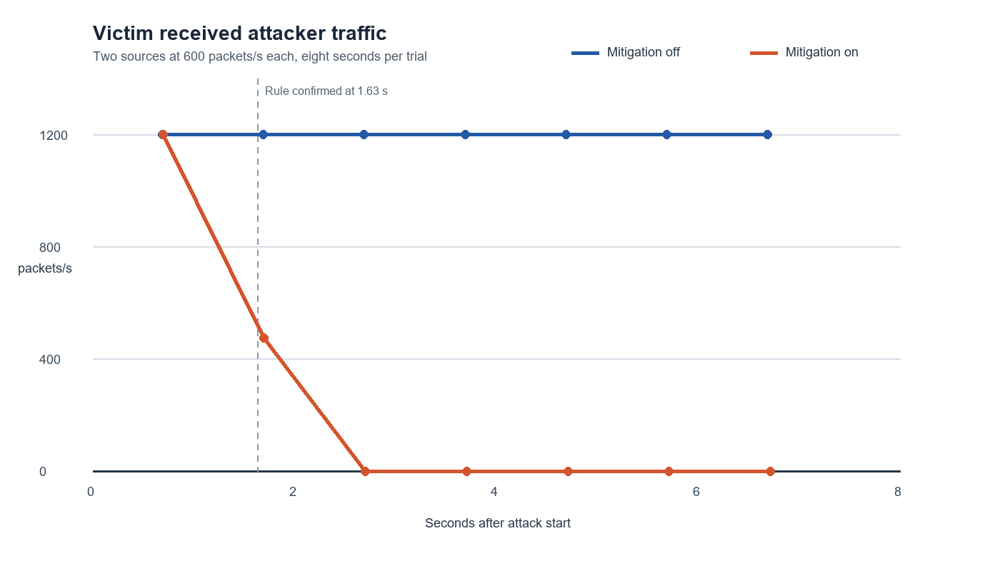

# FlowGuard controlled experiment results

**Run date:** 13 October 2026. **Scope:** one private Mininet switch, five hosts, one UDP echo service. All numerical outcomes below come from raw files in `results/`; [M4](../evidence/m4/RESULTS.md) and [M5](../evidence/m5/RESULTS.md) record the earlier milestone trials.

## Reproduce and inspect

Run as root in Ubuntu WSL from the repository root:

```bash
python3 -m unittest discover -s tests -v
python3 experiments/run_trial.py --mode baseline --output results/new-baseline
python3 experiments/run_trial.py --mode attack-off --output results/new-off --pps 600 --duration-s 8
python3 experiments/run_trial.py --mode attack-on --output results/new-on --pps 600 --duration-s 8
python3 experiments/analyze.py results/new-off results/new-on
```

The checked-in runs are `m4-baseline`, `m6-attack-off`, and `m6-attack-on`. `python3 experiments/summarize.py` regenerates `results/m6-summary.json` and `results/m6-rate-comparison.svg` from those files. `experiments/render_chart_png.py` regenerates the PNG chart when Pillow is available.

The controller writes timestamped JSONL samples, alerts, rule requests, barrier confirmations and removals. The victim writes per-second receive counts by source. The client writes every probe result to CSV. Each trial also saves flow-table dumps, generator start/stop records and metadata. Files ending in `.log` are local diagnostics and are not required to recalculate the reported metrics.

## Environment and traffic settings

Ubuntu 26.04 LTS in WSL2; kernel `6.18.33.2-microsoft-standard-WSL2`; Python 3.14.4; Mininet `2.3.0-1.1build1`; Open vSwitch `3.7.1-2`; OS-Ken `4.1.1-1ubuntu2`. WSL saw a 12th Gen Intel Core i5-12450HX with 12 logical CPUs and 7,981,708 kB of total guest memory. The topology had no NAT or external link. The controller used one-second polls, a 100-packets/s victim threshold, a 30-packets/s source threshold, two consecutive high windows, and 10-second mitigation rules.

The matched attacks used two hosts at 600 packets/s each for eight seconds, 128-byte application payloads, and one client echo probe every 100 ms. The generator can only target `10.0.0.10:9000` and limits each host to 2,000 packets/s for at most 30 seconds. No random payload or random source selection was used, so a seed was unnecessary.

## Results against the project targets

| Measure | Project target | Observed | Outcome |
| --- | ---: | ---: | --- |
| Normal service | At least 95% of 100 probes | Client 600/600; second benign sender 600/600 | Met |
| False mitigations during at least 5 min normal traffic with a short two-source burst | 0 | 0 alerts and 0 drop requests across 307 controller samples | Met |
| Two-source alert latency | At most 5 s | 1.555 s from earliest generator start record | Met |
| Source attribution | Both sources identified | `10.0.0.21` and `10.0.0.22` | Met |
| Mitigation activation | Record switch confirmation | Barrier reply at 1.634 s | Recorded |
| Victim-received attacker rate after activation | At least 90% lower than unmitigated matched windows | 1,199.956 packets/s off vs 0 packets/s on, 100% reduction | Met |
| Legitimate service during mitigated attack | At least 95% probe success | 80/80, or 100% | Met |
| Attack rule recovery | No drop rules within 15 s after attack | Both expired about 3.6 s after attack end; none in recovery flow table | Met |

The reduction compares complete one-second victim windows starting at least 0.5 seconds after the mitigation barrier, at the same relative times in the disabled trial. Across *all* complete attack windows, including the detection delay, the observed attacker rate was 1,200.023 packets/s without mitigation and 239.244 packets/s with mitigation, an approximately 80.1% whole-trial reduction. These are different measures and should not be interchanged.



## Interpretation and limitation

The defender removed attacker traffic from the victim after switch confirmation while retaining the legitimate client's service. The unmitigated client also succeeded 80/80 times at 1,200 aggregate attacker packets/s. An exploratory bounded maximum-load trial at 2,000 packets/s from each attacker (about 4,000 packets/s total) still produced 80/80 client replies without mitigation. Therefore these experiments do **not** show improved service availability. They show selective filtering, attribution, timely rule installation and recovery under the stated lab conditions. A different bottleneck or service model would be needed to test availability improvement.

The generator start timestamp is logged immediately before the first packet is sent, so latency is an approximation to first-packet latency. The trials share one WSL host and one switch, and do not establish internet-scale performance, cross-machine robustness, or false-positive rates for untested traffic patterns. Raw files and the analyzer make these exact claims auditable.

The review command in [DEMO.md](DEMO.md) reproduces one mitigated trial and prints each stage live. Its clean-source rehearsal is recorded in [M7 evidence](../evidence/m7/RESULTS.md); the M6 matched trials above remain the comparison used for the report.
